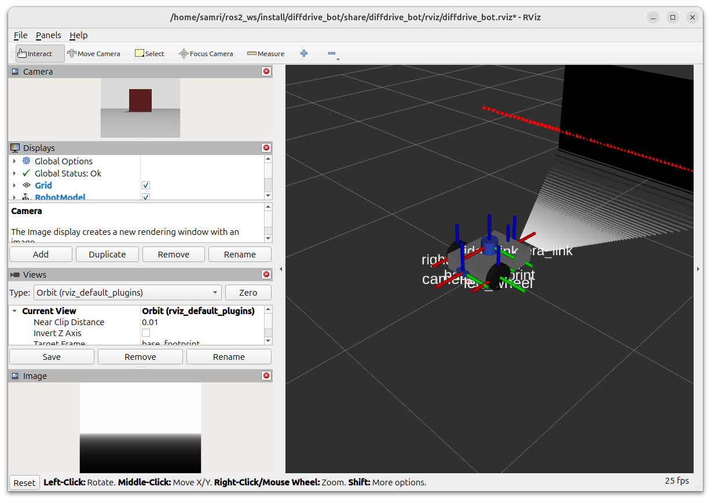
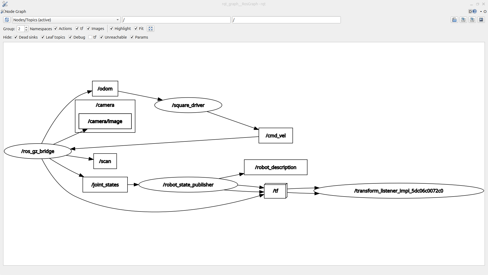

# Lab 1 Exercise

My solution for the Lab 1 exercise (Introduction to Robotics and Intelligent Systems). I ran everything on Ubuntu with ROS 2 and Gazebo.

There are four packages:

- `diffdrive_bot` is the lab robot. I added a depth camera and an IMU to it.
- `lab_interfaces` is the lab's own message, service and action types. I didn't change it.
- `my_robot_interfaces` has my types: `RobotStatus.msg`, `SetTurnSpeed.srv` and `Rotate.action`.
- `my_robot_nodes` has my nodes (`turn_away`, `rotate_server`, `square_driver`) and `square.launch.py`.

## Build

Clone it into the `src` folder of a workspace and build:

```bash
cd ~/ros2_ws/src
git clone https://github.com/Samri-A/intro_robotics_intelligent_systems_labs.git
cd ~/ros2_ws
colcon build --symlink-install
source install/setup.bash
```

If the course repo is in the same workspace, add a `COLCON_IGNORE` file to its `lab_01` folder first. Otherwise colcon finds two `diffdrive_bot` and two `lab_interfaces` packages and refuses to build.

## Step 1: Depth camera and IMU

The depth camera is on the back of the chassis, turned half a turn so it looks backwards. The IMU sits in the middle of the chassis. I also added the IMU system to the world and the new topics to the bridge.

```bash
ros2 launch diffdrive_bot display.launch.py
ros2 run tf2_ros tf2_echo base_link depth_camera_link   
ros2 launch diffdrive_bot gazebo.launch.py
ros2 topic echo /imu                                   
```

### Depth image and point cloud in RViz



The depth image is bottom left and the point cloud is the wall and floor behind the robot. The wall reads about 1.69 m, which makes sense: its face is 1.9 m behind the robot and the camera is 0.215 m behind the centre.

## Steps 2 to 5: turn_away

Start the robot in one terminal and the node in another:

```bash
ros2 launch diffdrive_bot control.launch.py
ros2 run my_robot_nodes turn_away
```

- **Step 2:** it drives forward at 0.2 m/s. When `/obstacle` says something is too close, it stops and turns on the spot at 0.5 rad/s, away from the obstacle.
- **Step 3:** the two speeds are now the `forward_speed` and `turn_speed` parameters. They're read on every message, so you can change them while it runs:
  ```bash
  ros2 param set /turn_away forward_speed 0.4
  ```
- **Step 4:** it publishes a `RobotStatus` on `/robot_status` every time an obstacle message comes in:
  ```bash
  ros2 topic echo /robot_status
  ```
- **Step 5:** it starts switched off. `/turn_away_enable` turns it on and off, and `/set_turn_speed` changes the turn speed (anything from just above 0 up to 1.5 rad/s).
  ```bash
  ros2 service call /turn_away_enable std_srvs/srv/SetBool "{data: true}"
  ros2 service call /set_turn_speed my_robot_interfaces/srv/SetTurnSpeed "{turn_speed: 1.0}"
  ros2 service call /set_turn_speed my_robot_interfaces/srv/SetTurnSpeed "{turn_speed: 3.0}"   # rejected
  ros2 service call /turn_away_enable std_srvs/srv/SetBool "{data: false}"
  ```

## Step 6: rotate_server

It turns the robot on the spot until it has turned through the goal angle. I add up the small change in yaw between odometry messages instead of subtracting the start yaw, so it still works when the yaw jumps from pi to -pi. It rejects a goal of 0 and stops the robot if the goal is canceled.

```bash
ros2 run my_robot_nodes rotate_server
ros2 action send_goal --feedback /rotate my_robot_interfaces/action/Rotate "{angle: 1.57}"
```

## Step 7: Driving a square

`square_driver` drives one side with `/drive_distance`, turns a quarter turn left with `/rotate`, and does that four times. If a goal fails it stops and logs which side it was on. The launch file starts everything in one go:

```bash
ros2 launch my_robot_nodes square.launch.py side_length:=0.8
```

### rqt_graph while square.launch.py runs



## What did not work

- `tf2_echo` gave a `frame does not exist` error when I first tested Step 1. I realized `tf2_echo` is just a listener and needs `robot_state_publisher` actively running in another terminal (via `display.launch.py` or `gazebo.launch.py`) to broadcast the transform tree.
- When launching `square.launch.py`, the first goal was sometimes rejected right away. `drive_distance_server` rejects goals if `self.position` is `None`, and because Gazebo takes a few seconds to spawn the model and start streaming `/odom`, `square_driver` was sending the goal too early. I solved this by having `square_driver` wait until the first `/odom` message is received before starting.
- When reorganizing packages into the folder structure, `colcon build` failed with CMake directory errors and ROS couldn't find `my_robot_nodes`. The old source paths were cached in `build/` and `install/`, so I had to remove `build`, `install`, and `log` and build fresh.
- Forgetting to source `install/setup.bash` in newly opened terminals caused `my_robot_interfaces` or node executables to not be found.
- The square drift: each in-place turn overshoots slightly (turning around 1.59 rad instead of exactly 1.57 rad) due to rotational inertia and the discrete control loop interval, causing the robot to finish a few centimeters away from its exact starting spot after four turns.
